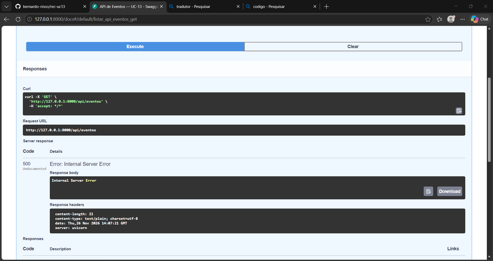
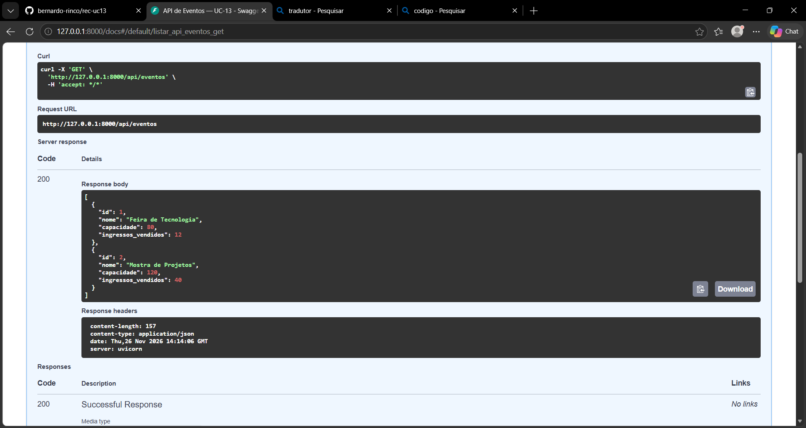

# Relatório técnico de manutenção

**Estudante:**  
**Data:** 26/11/2026

## Estado inicial e diagnóstico
1- Ao tentar consultar api/eventos foi me mostado um erro interno de servidor "Internal Server Error"

## Intervenções
1- Ao nalisando o código interno foi verificado que no arquivo "repositorio.py" o banco que estava conectado, estava vazio, então apos indentificar o problema, fiz a trocas por um outro banco com os devidos eventos já cadastrados.

## Validação
1- teste inicial =  / teste apos correção = .

## Entrega e versionamento
url do repositorio: https://github.com/bernardo-rinco/rec-uc13.git
1- commit 5bcd7892aab46ae84b1e37bd2fb83fd7df1514a9

