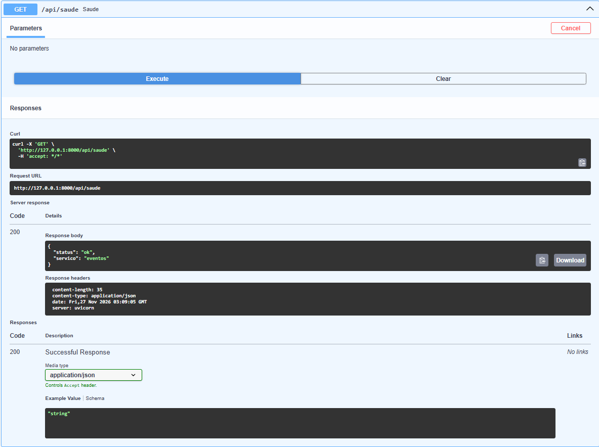

# Relatório técnico de manutenção

**Estudante:**  
**Data:** 27/11/2026

## Estado inicial e diagnóstico
1- Ao executar a rota "GET /api/eventos", o resultado fornecido não foi o esperado, a mensagem que apareceu foi "Internal Server Error".

## Intervenções
1- Analisando essa mensagem, foi notado que, no código do "repositorio.py", o banco que estava sendo referenciado para fazer as consultas era um banco vazio, então fizemos a mudança para um banco com valores existentes.

## Validação
0- 

1- 
1- 

## Entrega e versionamento
1- commit 5bcd7892aab46ae84b1e37bd2fb83fd7df1514a9