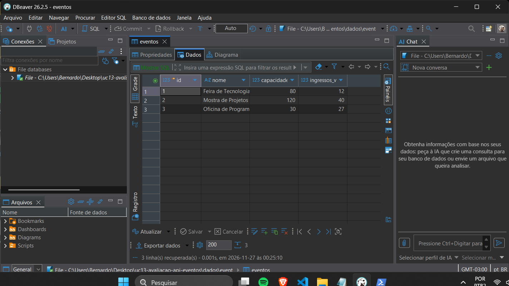

# Relatório técnico de manutenção

**Estudante:**  
**Data:** 27/11/2026

## Estado inicial e diagnóstico
1- Ao executar a rota "GET /api/eventos", o resultado fornecido não foi o esperado, a mensagem que apareceu foi "Internal Server Error".

2- Ao executar a rota "GET /api/eventos", foi notada a falta de um evento já cadastrado.

3- Na rota "POST /api/eventos", ao cadastrar dados válidos de um evento, foi notado que, em vez de aparecer o código HTTP 201 Created, estava aparecendo o código 200 OK.

4- Ao executar a rota GET /api/eventos/{evento_id}/disponibilidade, foi notado um erro, pois, ao comprar os ingressos, em vez de a API fazer a subtração de ingressos comprados menos a quantidade de ingressos disponíveis, ela estava fazendo o oposto e somando as duas.

## Intervenções
1- Analisando essa mensagem, foi notado que, no código do "repositorio.py", o banco que estava sendo referenciado para fazer as consultas era um banco vazio, então fizemos a mudança para um banco com valores existentes.

2- Abrimos o arquivo do banco de dados para realmente saber qual evento estava de fora da lista apresentada pela rota "GET /api/eventos". Ao comprovar que realmente havia um evento sendo ocultado, procuramos a raiz do porquê isso estava acontecendo e achamos o erro no código do arquivo "repositorio.py". O problema estava em uma regra de negócio inventada, que não existe em nenhum requisito, e isso faz com que haja um filtro e não mostre todos os eventos existentes naquele banco de dados. Para resolver esse problema de maneira simples, eu apenas removi e isolei essa regra de negócio do restante do código.

3- Ao analisar o código do arquivo "main.py", foi notado que o status "HTTP_200_OK" foi adicionado de maneira incorreta no código/decorador da rota. Após localizar o problema, foi feita a substituição para o devido código HTTP correspondente, "HTTP_201_CREATED".

## Validação
0- 

1- 
1- 

2- 
2- 

3- 
3- 
3- 

4- 
4- 
4- 
## Entrega e versionamento
1- commit 5bcd7892aab46ae84b1e37bd2fb83fd7df1514a9

2- commit 10fd1861cfde846493ecd8e0d1b76718c6ea65ba

3- commit 9296cd7b3161ed856fe07e71f6775783dd0daccb